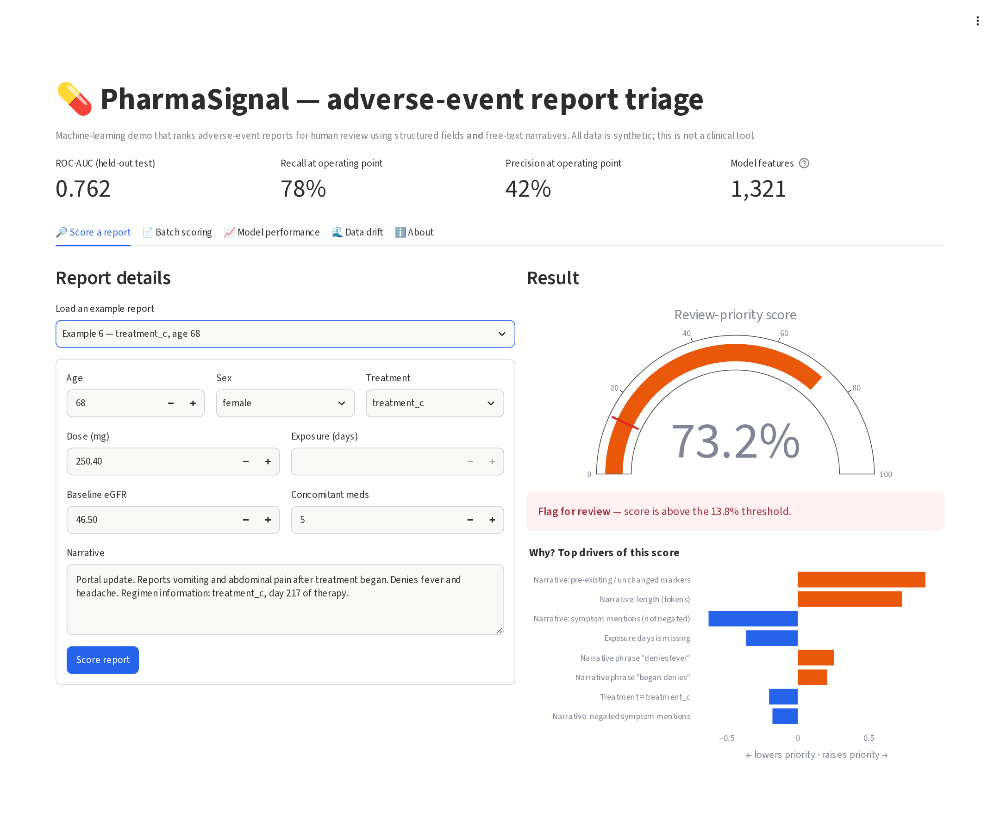
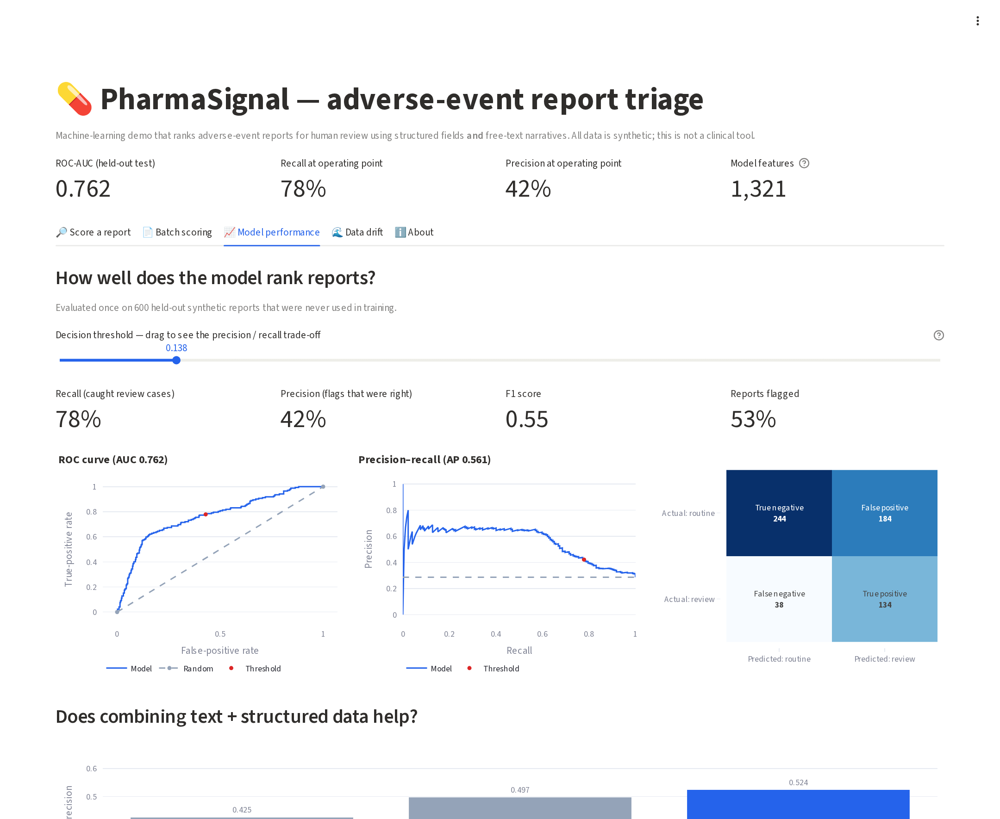
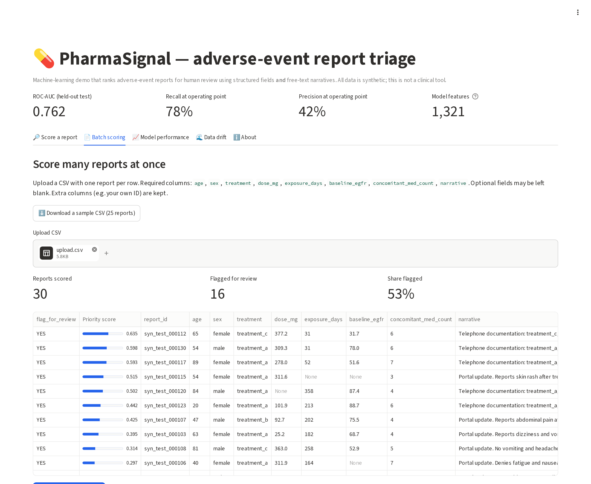
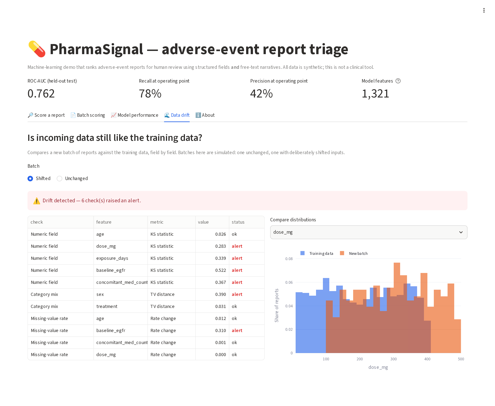
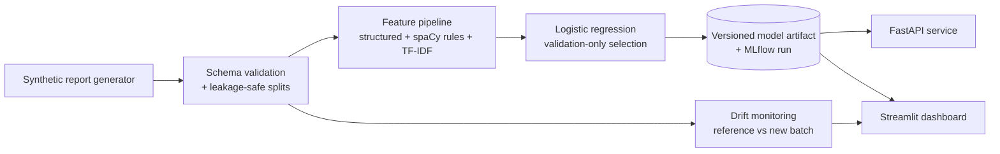

# PharmaSignal

**An end-to-end machine-learning system that ranks adverse-event reports for human review, using both structured fields and free-text narratives.**

It covers the full path from raw records to a working product: data validation → NLP and feature engineering → model training and evaluation → experiment tracking → a REST API → an interactive dashboard → data-drift monitoring, all backed by 200+ automated tests.



> **Note:** every record is synthetic and generated by code in this repo. No real patient data is used, and this is a portfolio demonstration, not a clinical tool.

---

## The problem

Safety teams receive large volumes of adverse-event reports. Each one mixes structured data (age, dose, treatment, lab values) with a free-text narrative such as *"Reports vomiting after treatment began. Denies fever."* Reviewers need to know which reports to read first.

PharmaSignal scores every report for **review priority**, flags the ones above a chosen threshold and shows **why** it scored each report that way.

## What's inside

| | |
|---|---|
| **Interactive dashboard** | Score a single report and see what drove the score, upload a CSV to score reports in bulk and download the results, explore model performance with a live threshold slider, and check incoming data for drift. Built with **Streamlit + Plotly**. |
| **NLP + tabular ML** | **spaCy** tokenisation, negation-aware rule features (*"denies fever"* ≠ *"fever"*), and TF-IDF n-grams, fused with structured fields in one **scikit-learn** pipeline. 1,321 features in total. |
| **Rigorous evaluation** | Leakage-safe splits, model and threshold chosen on validation data only, and the test set scored exactly once. Compares structured-only, text-only and combined models. |
| **REST API** | **FastAPI** service with strict input validation, health and readiness endpoints, and auto-generated OpenAPI docs. |
| **Experiment tracking** | **MLflow** logs parameters, metrics and the full model bundle, so every run is reproducible. |
| **Drift monitoring** | Compares new data with the training data using KS tests, total-variation distance and missing-value rates, with pre-registered alert thresholds. |
| **Engineering quality** | 208 tests (94% coverage, warnings treated as errors), Ruff linting, a locked dependency set, and bit-for-bit reproducible data and reports. |

## Results

Evaluated once on 600 held-out reports that were never used for training or tuning:

| Metric | Value |
|---|---|
| ROC-AUC | **0.762** |
| Average precision | **0.561** (base rate 0.29) |
| Recall at the chosen threshold | **78%** of review-worthy reports caught |
| Precision at the chosen threshold | **42%** |

Combining narrative text with structured fields beat either source alone (validation average precision: structured 0.425 → text 0.497 → **combined 0.524**).

<table>
<tr>
<td></td>
<td></td>
</tr>
<tr>
<td align="center"><b>Model performance:</b> drag the threshold to trade recall for precision</td>
<td align="center"><b>Batch scoring:</b> upload a CSV, get a ranked and downloadable result</td>
</tr>
<tr>
<td colspan="2"></td>
</tr>
<tr>
<td colspan="2" align="center"><b>Drift monitoring:</b> a deliberately shifted batch raises alerts on exactly the fields that were changed</td>
</tr>
</table>

## Architecture



## Quick start

Requires **Python 3.12** and **[uv](https://docs.astral.sh/uv/)**. Linux and macOS work as-is; on Windows use WSL.

```bash
git clone <this-repo-url> pharmasignal && cd pharmasignal

make setup       # install the exact locked dependencies into .venv
make artifacts   # generate data, train and track the model, build drift reports (~1 min)
make dashboard   # open http://localhost:8501
```

Other commands:

```bash
make test        # full test suite with coverage
make lint        # Ruff lint + format check
make api         # REST API on http://127.0.0.1:8000 (interactive docs at /docs)
make help        # list every command
```

<details>
<summary>Without <code>make</code></summary>

```bash
uv sync --frozen --python 3.12 --extra dashboard
.venv/bin/python -m pharmasignal.data.build --config configs/data.json --output artifacts/data/seed42
.venv/bin/python -m pharmasignal.models.tracking --data artifacts/data/seed42 --output artifacts/models/m4 --tracking-dir artifacts/mlflow
for s in shifted unchanged; do
  .venv/bin/python -m pharmasignal.monitoring.simulate --scenario $s --n 600 --output artifacts/data/simulated/$s
  .venv/bin/python -m pharmasignal.monitoring.report --reference artifacts/data/seed42 \
      --batch artifacts/data/simulated/$s --config configs/monitoring.json --output artifacts/monitoring/$s
done
.venv/bin/streamlit run src/pharmasignal/dashboard/app.py
```
</details>

### Calling the API

```bash
curl -s http://127.0.0.1:8000/predict -H 'Content-Type: application/json' -d '{
  "age": 68, "sex": "female", "treatment": "treatment_c",
  "dose_mg": 250.4, "exposure_days": null, "baseline_egfr": 46.5,
  "concomitant_med_count": 5,
  "narrative": "Portal update. Reports vomiting and abdominal pain after treatment began. Denies fever and headache. Regimen information: treatment_c, day 217 of therapy."
}'
```

```json
{"predicted_signal": 1, "signal_probability": 0.7323832477775062, "decision_threshold": 0.13818775588643972, "model_version": "baseline-a28dc00666102c16", "schema_version": "1.0.0"}
```

Every field is required (use `null` for unknown optional values). Unknown fields, out-of-range numbers and type mismatches are rejected with a `422` that never echoes the input.

### Docker

`make docker` builds a slim Python 3.12 image (hash-pinned dependencies, non-root user, built-in health check) and serves the API on `http://127.0.0.1:8000`. The image has been built and tested: health check passes and predictions match the local model exactly.

## Project structure

```text
src/pharmasignal/
  data/         synthetic generator, schema, strict validation, split checks
  features/     spaCy text rules + TF-IDF + structured preprocessing (scikit-learn)
  models/       training, evaluation, threshold selection, MLflow tracking, artifacts
  serving/      FastAPI app and request/response schemas
  monitoring/   drift metrics, simulated batches, drift reports
  dashboard/    Streamlit app (app.py) and testable helper logic (logic.py)
tests/          208 tests: unit, integration, live HTTP and headless dashboard
configs/        generator settings and drift-alert thresholds
docs/           technical write-up, architecture and design notes
```

## Tech stack

Python 3.12 · pandas · NumPy · SciPy · scikit-learn · spaCy · MLflow · FastAPI · Pydantic · Uvicorn · Streamlit · Plotly · pytest · Ruff · uv · Docker

## Limitations

- **Synthetic data.** Scores reflect the data generator, not real-world risk, and the model has no clinical validation.
- **Interpretable baseline, by design.** Logistic regression is transparent and explains each score; transformer models were not needed for this task.
- **Simulated drift batches.** Drift monitoring works on input distributions; detecting performance drop would need fresh labels.
- **Not deployed to the cloud.** A production architecture for AWS (ECS Fargate, canary releases) is designed in [docs/M7_PRODUCTION.md](docs/M7_PRODUCTION.md) but not provisioned.

## Further reading

- [Technical details](docs/TECHNICAL_DETAILS.md): full methodology, exact numbers and design decisions
- [Architecture](docs/ARCHITECTURE.md) · [Dataset strategy](docs/DATASET_STRATEGY.md) · [Drift methodology](docs/M6_DRIFT.md) · [API service](docs/M5_SERVING.md)
